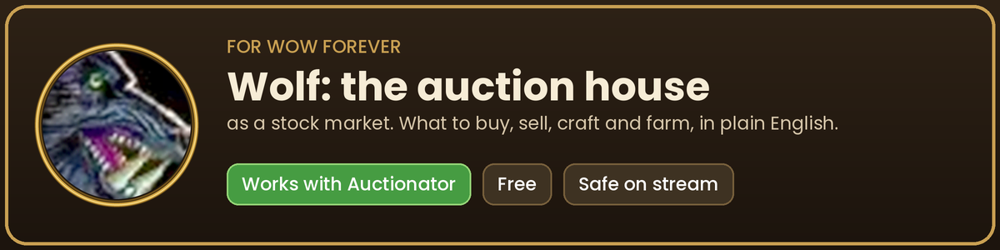

# Wolf: the WoW Forever auction house as a stock market

Wolf watches the auction house and tells you, in plain English, how to make gold: what to buy, what to sell, what to craft, what to farm, and what's coming next week. Open it with `/wolf` or the wolf by your minimap.

## Getting started

1. **Install Wolf** with the CurseForge app (or WowUp), then restart the game fully the first time (new addons load at launch, not on `/reload`).
2. **Have Auctionator?** Wolf reads its scans, so one scan fills both. No Auctionator: Wolf's own scan button at the auction house does the same.
3. **Play with your guild.** Wolf users in the same guild or group share their prices, sales and farm finds in hidden addon messages, so everyone's prices stay fresh.

That's it. Wolf takes it from there.

---

## What's inside

**Today**: what everything you own is worth, a calendar of what's coming (the Darkmoon Faire, battleground weeks, the raids), your best moves (including listings someone undercut), and what sold while you were away.

**Market**: search any item for its verdict, one clean price chart, when it sells best, where it comes from, and what it costs to craft.

**Make gold**

- **Flip it**: deals worth buying and relisting.
- **Craft it**: what your recipes make in profit, a shopping list, the cheapest way to level a profession, and recipes worth learning.
- **Farm it**: the best materials for your level and professions. **Drops**: loot worth farming a mob for, ranked by steady gold an hour, with no world epics that drop 1 in 100,000 anywhere. **Dungeons**: every dungeon and wing's gold a run, in a group or solo. Every item's **Where to farm it** gives the best way for you to get it first.
- **Raids** and **PvP**: what raiders and battlegrounds burn through, and when to stock up.

**You**: what you own across your characters at a glance, farming sessions that track themselves, and a journal of what you bought and sold.

**Calculator**: what buying or selling any amount comes to at today's price, after the auction house's cut.

Every call is one of six verdicts: **BUY**, **SELL**, **HOLD**, **WAIT**, **CRAFT**, **FARM**.

---

## Safe on stream

No pop-ups, no sounds. Wolf only speaks in a chat line, and the session tracker stays off your screen unless you pin it.

## Good to know

- `/wolf` opens the window; `/wolf news` shows what's new.
- Don't run ForeverTrading at the same time: two scanners do the same work twice.
- Turn off guild sharing any time in Settings > Exchange.

---

## Credits

Wolf is free software under the GNU GPL v3, built on [ForeverTrading](https://github.com/thewoolfi/ForeverTrading) by thewoolfi (Apache 2.0). Where items come from: [ForeverDB](https://github.com/foreverfraddons/forever-db), with QuestieDB, VMaNGOS, cMaNGOS, AllTheThings, pfQuest and the [Drop Tables](https://github.com/valcheffnet/DropTables) contributors (CC BY-SA 4.0). Full credits: `/wolf credits` and NOTICE.

Source and every release: [github.com/PetcoWoW/ForeverTrading](https://github.com/PetcoWoW/ForeverTrading)
