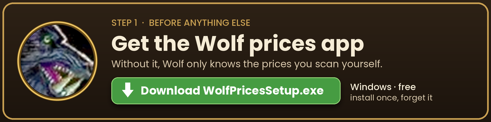

# ⬇️ [Download the Wolf prices app (WolfPricesSetup.exe)](https://github.com/PetcoWoW/ForeverTrading/releases/download/companion/WolfPricesSetup.exe)

**Do this first.** Addons can't go online, so without this app Wolf only knows the prices you scan yourself. The app fetches every price on your realm and hands them to Wolf, so it's up to date when you log in.

1. **Download** it (the link above).
2. **Open it and click Install.** Done. You never open it again.
3. **Play.** When newer prices (or a newer Wolf) are waiting, a chat line says so: click **Load them**. The app keeps Wolf itself up to date too.

> **"Windows protected your PC"?** Click **More info**, then **Run anyway**. It's a new app, so Windows doesn't know it yet.

Windows only · free · no account · no admin rights · nothing on screen while you play · checks every 15 minutes · remove it any time in Windows Settings > Apps.

*Not on Windows? Wolf still works with your own scans and prices from Wolf users in your guild.*

---

# Wolf: the WoW Forever auction house as a stock market

Wolf watches every price on the WoW Forever auction house and tells you, in plain English, how to make gold: what to buy, what to sell, what to craft, what to farm, and what's coming next week.

**Install:** get Wolf here with the CurseForge app (or WowUp). Restart the game fully the first time (new addons load at launch, not on `/reload`), then type `/wolf`.

---

## What's inside

**Today**: what everything you own is worth, a calendar of what's coming (the Darkmoon Faire, battleground weeks, the raids), your best moves (undercut listings, what to post tonight), what you own that moved, and what sold while you were away.

**Market**: the market's mood, gainers and losers, the most traded items. Search any item: the verdict first, one clean chart, when it sells best, where it comes from, and what it costs to craft.

**Make gold**

- **Flip it**: deals worth buying and relisting.
- **Craft it**: your recipes' profit, a craft queue with the shopping list, the cheapest way to level a profession, recipes worth learning.
- **Farm it**: the best materials for your level and professions. **Drops**: loot worth farming a mob for, ranked by steady gold an hour (no world epics that drop 1 in 100,000 anywhere). **Dungeons**: each dungeon and wing's steady gold a run, split five ways, rare drops apart. Every item's **Where to farm it** gives the best way for you to get it first.
- **Raids** and **PvP**: what raiders and battlegrounds burn through, and when to stock up.

**You**: everything across your characters (bags, bank, mail, listings, gold), gold an hour, and a journal of what you bought and sold.

**Calculator**: what buying or selling any amount comes to at today's price, after the auction house's cut.

Every call is one of six verdicts: **BUY**, **SELL**, **HOLD**, **WAIT**, **CRAFT**, **FARM**.

---

## The Wolf network

Wolf users in your guild or group share prices, sales, farm rates and watchlist deals in hidden addon messages. A price far from what's known waits until a second user agrees, so one bad scan can't fool everyone. Off in Settings > Exchange.

## Safe on stream

No pop-ups, no sounds. Wolf only speaks in a chat line. The session tracker folds down to one small bar.

## Good to know

- `/wolf` opens the window; `/wolf news` shows what's new.
- Don't run ForeverTrading at the same time: two scanners do the same work twice.
- The prices app only touches Wolf's own price file: no accounts, no game memory, nothing sent anywhere.

---

## Credits

Wolf is free software under the GNU GPL v3, built on [ForeverTrading](https://github.com/thewoolfi/ForeverTrading) by thewoolfi (Apache 2.0). Where items come from: [ForeverDB](https://github.com/foreverfraddons/forever-db), with QuestieDB, VMaNGOS, cMaNGOS, AllTheThings, pfQuest and the [Drop Tables](https://github.com/valcheffnet/DropTables) contributors (CC BY-SA 4.0). Full credits: `/wolf credits` and NOTICE.

Source, the price robot and every release: [github.com/PetcoWoW/ForeverTrading](https://github.com/PetcoWoW/ForeverTrading)
